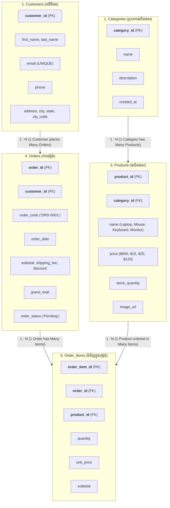
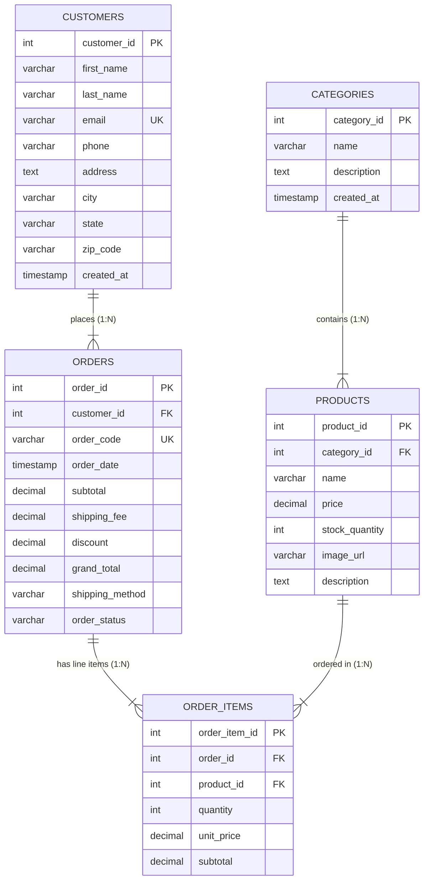

# E-Commerce Practical Exercise Solution Report
**Course:** Year 3 Semester 2 &bull; React.js &amp; Database Design Practical Exercises

---

## 1. Overview of Completed Exercises

All tasks assigned by the instructor across the 4 slides/pages have been implemented and verified:

1. **Practical Exercise 1: Products & Shopping Cart**
   - 4 specified products: Laptop (\$650), Mouse (\$15), Keyboard (\$25), Monitor (\$120)
   - Add to Cart button with responsive count feedback
   - Shopping Cart page with item view, quantity increment/decrement (`+` / `-`), item removal, live Subtotal and Grand Total calculation, and "Proceed to Checkout" button.
2. **Practical Exercise 2: Checkout Form & Validation**
   - Customer input fields: First Name, Last Name, Email, Phone Number, Street Address, City, State/Province, Zip Code, and Delivery Notes.
   - Comprehensive required field and format validation (email regex and phone length validation).
   - Shipping method selection (Free Shipping \$0 vs Express Shipping \$9).
   - Live Order Summary displaying items, subtotal, shipping fee, discount coupon, and Grand Total.
   - Place Order button.
3. **Practical Exercise 3: Order Confirmation**
   - Message: **"Order Placed Successfully!"**
   - Order ID: **ORD-0001** (auto-incrementing sequential tracking)
   - Customer Name
   - Order Date & Time
   - Ordered Products itemized breakdown
   - Total Amount (Grand Total)
   - Order Status: **Pending**
4. **Practical Exercise 4: Database Design (ERD)**
   - Entity-Relationship Diagram (ERD) connecting:
     1. `Customers`
     2. `Categories`
     3. `Products`
     4. `Orders`
     5. `Order_Items`
   - Data types, Primary Keys (PK), Foreign Keys (FK), and Cardinalities (1:N).
   - Complete SQL DDL scripts ready for submission and execution.

---

## 2. Practical Exercise 1: Products & Cart Data

| Product ID | Product Name | Category | Unit Price | Description |
| :--- | :--- | :--- | :--- | :--- |
| 1 | **Laptop** | Computers | \$650.00 | High-performance laptop for study and work |
| 2 | **Mouse** | Accessories | \$15.00 | Ergonomic 2.4GHz wireless mouse |
| 3 | **Keyboard** | Accessories | \$25.00 | RGB backlit mechanical keyboard |
| 4 | **Monitor** | Displays | \$120.00 | 27-inch IPS Full HD display |

### Shopping Cart Calculations
- **Subtotal:**
  $$\text{Subtotal} = \sum_{i=1}^{n} (\text{Price}_i \times \text{Quantity}_i)$$
- **Grand Total:**
  $$\text{Grand Total} = \text{Subtotal} + \text{Shipping Fee} - \text{Discount}$$

---

## 3. Practical Exercise 2: Checkout Form & Validation Rules

| Field Name | Type | Requirement | Validation Rule |
| :--- | :--- | :--- | :--- |
| First Name | String | Required | Non-empty string |
| Last Name | String | Required | Non-empty string |
| Email | Email | Required | Valid email pattern `^[^\s@]+@[^\s@]+\.[^\s@]+$` |
| Phone Number | String | Required | Minimum 8 characters |
| Address | Text | Required | Non-empty street address |
| City | String | Required | Non-empty city name |
| State | String | Required | Non-empty province/state |
| Zip Code | String | Required | Non-empty postal code |
| Shipping Method | Radio Option | Required | Free (\$0, 7-20 Days) or Express (\$9, 1-3 Days) |

---

## 4. Practical Exercise 3: Order Confirmation Specifications

Upon clicking **"Place Order"**, the order confirmation view presents:
- **Success Banner:** `Order Placed Successfully!` (or `ការកុម្ម៉ង់បានជោគជ័យ!`)
- **Order ID:** `ORD-0001`
- **Customer Name:** Full Name (`<First Name> <Last Name>`)
- **Order Date:** Current timestamp (e.g., `Nov 22, 2026, 01:30 PM`)
- **Ordered Products:** Itemized list including product image, name, unit price, quantity, and line total
- **Total Amount:** Final calculated grand total
- **Order Status:** `Pending` (amber status tag)

---

## 5. Practical Exercise 4: Database Design & ERD

### Visual Box ERD Diagram (គំនូសតាង ERD)

```text
  ┌─────────────────────────────────┐              ┌─────────────────────────────────┐
  │         CATEGORIES (1)          │              │          CUSTOMERS (1)          │
  ├─────────────────────────────────┤              ├─────────────────────────────────┤
  │ [PK] category_id    INT (AI)    │              │ [PK] customer_id    INT (AI)    │
  │      name           VARCHAR(100)│              │      first_name     VARCHAR(100)│
  │      description    TEXT        │              │      last_name      VARCHAR(100)│
  │      created_at     TIMESTAMP   │              │      email          VARCHAR(150)│
  └────────────────┬────────────────┘              │      phone          VARCHAR(30) │
                   │                               │      address        TEXT        │
                   │ 1                             │      city, state    VARCHAR(100)│
                   │ (contains)                    │      zip_code       VARCHAR(20) │
                   │                               └────────────────┬────────────────┘
                   │ N                                              │ 1
  ┌────────────────▼────────────────┐                               │ (places)
  │          PRODUCTS (N)           │                               │
  ├─────────────────────────────────┤                               │ N
  │ [PK] product_id     INT (AI)    │              ┌────────────────▼────────────────┐
  │ [FK] category_id    INT ────────┘              │           ORDERS (N)            │
  │      name           VARCHAR(150)               ├─────────────────────────────────┤
  │      price          DECIMAL(10,2)              │ [PK] order_id       INT (AI)    │
  │      stock_quantity INT                        │ [FK] customer_id    INT ────────┘
  │      image_url      VARCHAR(255)               │      order_code     VARCHAR(50) │
  │      description    TEXT                       │      order_date     TIMESTAMP   │
  └────────────────┬────────────────┘              │      subtotal       DECIMAL     │
                   │                               │      shipping_fee   DECIMAL     │
                   │ 1                             │      discount       DECIMAL     │
                   │                               │      grand_total    DECIMAL     │
                   │                               │      shipping_method VARCHAR(50)│
                   │                               │      order_status   VARCHAR(50) │
                   │ N                             └────────────────┬────────────────┘
                   │                                                │ 1
                   │                                                │ (contains)
                   │                                                │ N
  ┌────────────────▼────────────────────────────────────────────────▼────────────────┐
  │                                 ORDER_ITEMS (N)                                  │
  ├──────────────────────────────────────────────────────────────────────────────────┤
  │ [PK] order_item_id    INT AUTO_INCREMENT                                         │
  │ [FK] order_id         INT (Foreign Key -> Orders.order_id)                       │
  │ [FK] product_id       INT (Foreign Key -> Products.product_id)                     │
  │      quantity         INT                                                        │
  │      unit_price       DECIMAL(10,2)                                              │
  │      subtotal         DECIMAL(10,2)  -- (quantity * unit_price)                  │
  └──────────────────────────────────────────────────────────────────────────────────┘
```

### Mermaid Visual Relationship Flowchart



### Standard Entity-Relationship Diagram (ERD)



### Table Relationships & Cardinality Explanation

1. **`Categories` &rarr; `Products` (One-to-Many / 1:N)**
   - One category can hold multiple products (e.g., the *Accessories* category contains both Mouse and Keyboard).
   - Each product belongs to exactly one category (`category_id` in `Products` is the Foreign Key referencing `category_id` in `Categories`).
2. **`Customers` &rarr; `Orders` (One-to-Many / 1:N)**
   - One customer can place many orders over time.
   - Each order is placed by one specific customer (`customer_id` in `Orders` is the Foreign Key referencing `customer_id` in `Customers`).
3. **`Orders` &rarr; `Order_Items` (One-to-Many / 1:N)**
   - One order can contain multiple items (line items).
   - Each line item belongs strictly to one order (`order_id` in `Order_Items` references `order_id` in `Orders`).
4. **`Products` &rarr; `Order_Items` (One-to-Many / 1:N)**
   - One product can be purchased in many different order items across multiple customer orders.
   - `Order_Items` functions as the **Junction / Associative Table** resolving the Many-to-Many ($M:N$) relationship between `Orders` and `Products`.

---

## 6. SQL DDL Implementation Script

```sql
-- ==========================================
-- E-Commerce Order Database Schema
-- Practical Exercise Database Design
-- ==========================================

-- 1. Table: Customers
CREATE TABLE Customers (
    customer_id INT AUTO_INCREMENT PRIMARY KEY,
    first_name VARCHAR(100) NOT NULL,
    last_name VARCHAR(100) NOT NULL,
    email VARCHAR(150) NOT NULL UNIQUE,
    phone VARCHAR(30) NOT NULL,
    address TEXT NOT NULL,
    city VARCHAR(100) NOT NULL,
    state VARCHAR(100) NOT NULL,
    zip_code VARCHAR(20) NOT NULL,
    created_at TIMESTAMP DEFAULT CURRENT_TIMESTAMP
);

-- 2. Table: Categories
CREATE TABLE Categories (
    category_id INT AUTO_INCREMENT PRIMARY KEY,
    name VARCHAR(100) NOT NULL,
    description TEXT,
    created_at TIMESTAMP DEFAULT CURRENT_TIMESTAMP
);

-- 3. Table: Products
CREATE TABLE Products (
    product_id INT AUTO_INCREMENT PRIMARY KEY,
    category_id INT NOT NULL,
    name VARCHAR(150) NOT NULL,
    price DECIMAL(10, 2) NOT NULL,
    stock_quantity INT NOT NULL DEFAULT 0,
    image_url VARCHAR(255),
    description TEXT,
    created_at TIMESTAMP DEFAULT CURRENT_TIMESTAMP,
    FOREIGN KEY (category_id) REFERENCES Categories(category_id) ON DELETE CASCADE
);

-- 4. Table: Orders
CREATE TABLE Orders (
    order_id INT AUTO_INCREMENT PRIMARY KEY,
    customer_id INT NOT NULL,
    order_code VARCHAR(50) NOT NULL UNIQUE, -- e.g., 'ORD-0001'
    order_date TIMESTAMP DEFAULT CURRENT_TIMESTAMP,
    subtotal DECIMAL(10, 2) NOT NULL,
    shipping_fee DECIMAL(10, 2) DEFAULT 0.00,
    discount DECIMAL(10, 2) DEFAULT 0.00,
    grand_total DECIMAL(10, 2) NOT NULL,
    shipping_method VARCHAR(50) DEFAULT 'Free Shipping',
    order_status VARCHAR(50) DEFAULT 'Pending',
    FOREIGN KEY (customer_id) REFERENCES Customers(customer_id) ON DELETE CASCADE
);

-- 5. Table: Order_Items
CREATE TABLE Order_Items (
    order_item_id INT AUTO_INCREMENT PRIMARY KEY,
    order_id INT NOT NULL,
    product_id INT NOT NULL,
    quantity INT NOT NULL,
    unit_price DECIMAL(10, 2) NOT NULL,
    subtotal DECIMAL(10, 2) NOT NULL,
    FOREIGN KEY (order_id) REFERENCES Orders(order_id) ON DELETE CASCADE,
    FOREIGN KEY (product_id) REFERENCES Products(product_id) ON DELETE CASCADE
);

-- ==========================================
-- Sample Data Insertion (Exercise Products)
-- ==========================================
INSERT INTO Categories (category_id, name, description) VALUES
(1, 'Computers', 'Laptops and workstations'),
(2, 'Accessories', 'Input devices and peripherals'),
(3, 'Displays', 'Monitors and screens');

INSERT INTO Products (product_id, category_id, name, price, stock_quantity) VALUES
(1, 1, 'Laptop', 650.00, 50),
(2, 2, 'Mouse', 15.00, 200),
(3, 2, 'Keyboard', 25.00, 150),
(4, 3, 'Monitor', 120.00, 80);
```

---

## 7. Project File Structure

- [cart.jsx](file:///d:/Learn_PG-A_Year3_P2/Step1/React%20Code/myweb/react_web/src/cart.jsx): Main controller with React state for cart items, customer info, shipping methods, and view switching.
- [data.js](file:///d:/Learn_PG-A_Year3_P2/Step1/React%20Code/myweb/react_web/src/components/ProjectCart/data.js): Products list (Laptop \$650, Mouse \$15, Keyboard \$25, Monitor \$120) and shipping options.
- [Navbar.jsx](file:///d:/Learn_PG-A_Year3_P2/Step1/React%20Code/myweb/react_web/src/components/ProjectCart/Navbar.jsx): Navigation header matching the assignment mockups with live badge counter.
- [ProductList.jsx](file:///d:/Learn_PG-A_Year3_P2/Step1/React%20Code/myweb/react_web/src/components/ProjectCart/ProductList.jsx): Product catalog with "Add to Cart" buttons.
- [CartView.jsx](file:///d:/Learn_PG-A_Year3_P2/Step1/React%20Code/myweb/react_web/src/components/ProjectCart/CartView.jsx): Shopping Cart page featuring quantity update (+/-), item removal, subtotal, and "Proceed to Checkout".
- [CheckoutView.jsx](file:///d:/Learn_PG-A_Year3_P2/Step1/React%20Code/myweb/react_web/src/components/ProjectCart/CheckoutView.jsx): Full customer checkout form with validation and shipping method selector.
- [OrderConfirmationView.jsx](file:///d:/Learn_PG-A_Year3_P2/Step1/React%20Code/myweb/react_web/src/components/ProjectCart/OrderConfirmationView.jsx): Order confirmation screen (ORD-0001, customer details, pending status, print invoice).
- [DatabaseERDView.jsx](file:///d:/Learn_PG-A_Year3_P2/Step1/React%20Code/myweb/react_web/src/components/ProjectCart/DatabaseERDView.jsx): In-app interactive ERD viewer with visual diagrams, schema tables, and copyable SQL script.
